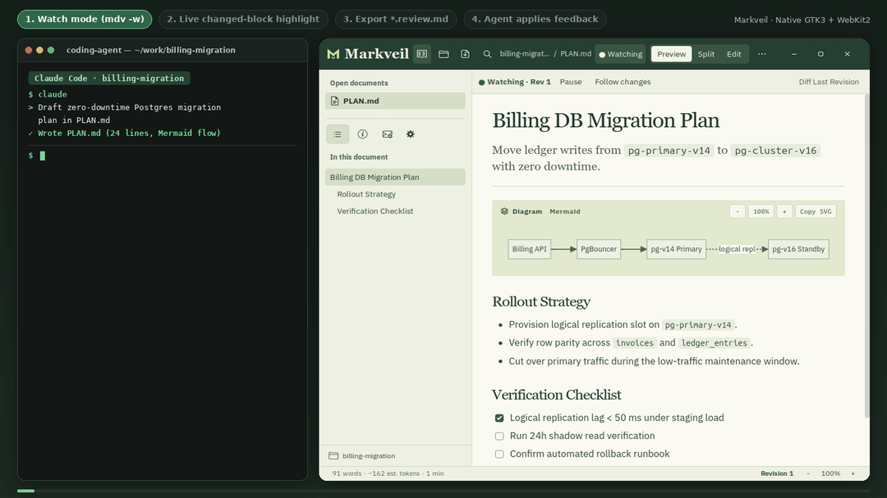
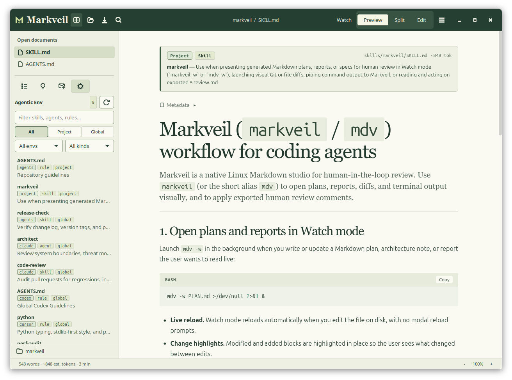
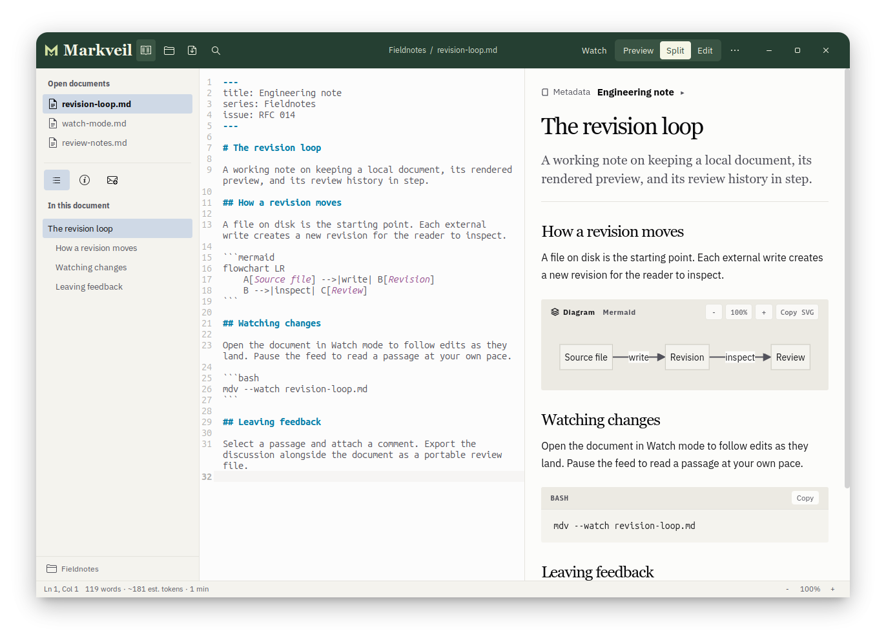
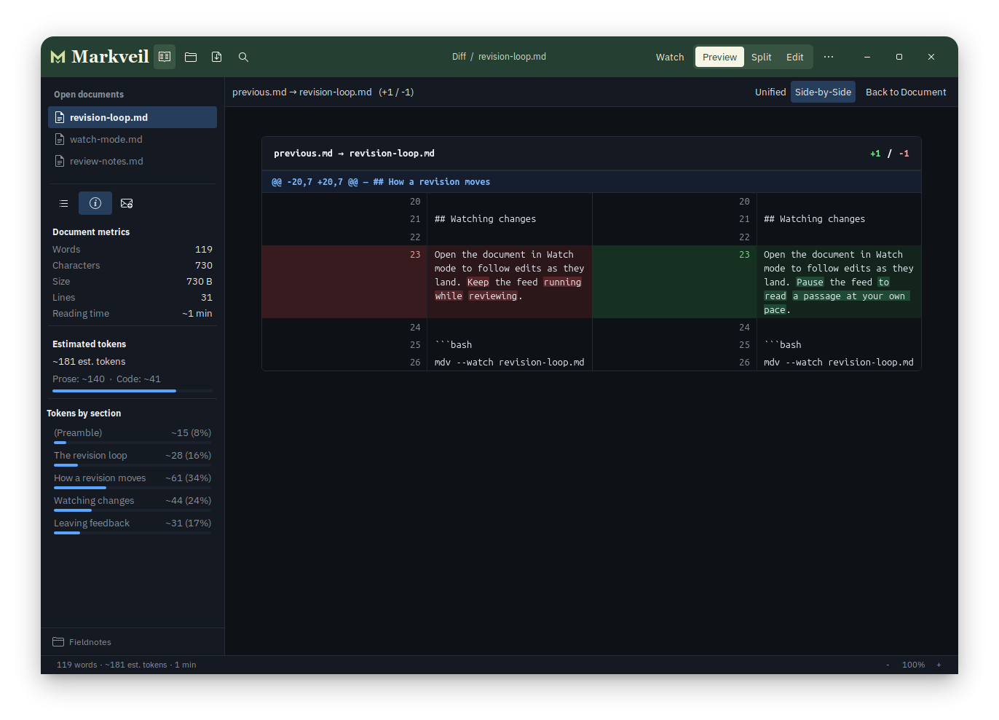
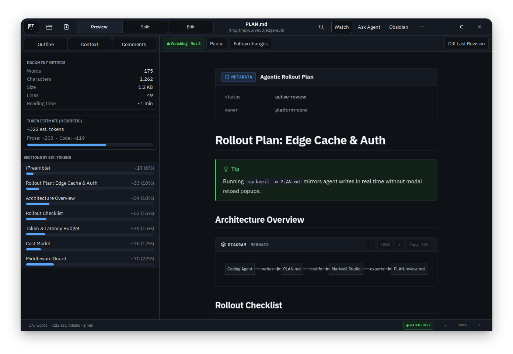

<div align="center">
  
  <h1>Markveil</h1>
  <p><strong>Native GTK3 + WebKit2 Markdown studio for Linux and local coding-agent workflows.</strong></p>
  <p>Offline KaTeX &amp; Mermaid · Agentic Env browser · Watch mode · Visual diffs · 9 local agent CLIs · Portable <code>*.review.md</code> feedback</p>
  <p>
    <a href="https://github.com/abbycantcode/Markveil/actions/workflows/ci.yml"></a>
    <a href="https://github.com/abbycantcode/Markveil/releases/latest"></a>
    <a href="LICENSE"></a>
    
  </p>
</div>

<p align="center">
  
</p>

## Why Markveil

Most Linux Markdown tools fall into two groups: Electron workspaces that consume hundreds of megabytes of RAM, or bare readers that lack Mermaid diagrams, math, diffs, and live reload. **Markveil** (`markveil`, short alias `mdv`, compatibility alias `md-viewer`) is a native desktop app built for reading, editing, and reviewing technical Markdown, source files, and coding-agent artifacts with single-render startup and cached local rendering.

| Capability | Markveil (`mdv`) | Electron apps (Obsidian, VS Code) | Minimal viewers |
|---|---|---|---|
| Cold CLI startup | ~170 ms (single-render) | 1.5 – 4 s | <50 ms |
| Native GTK3 + WebKit2 | Yes (no Electron or Node) | No (Chromium) | Terminal or basic widget |
| Offline KaTeX + Mermaid | Bundled locally | Plugin or network dependent | Usually unsupported |
| Agentic Env discovery & classification | Built-in (global + project) | None | None |
| Watch mode + changed-block highlight | Built-in (`-w`) | External extension | None |
| Context, token & artifact inspector | Built-in | None | None |
| Portable `*.review.md` round-trip | Built-in (`Ctrl+Shift+M`) | None | None |
| Visual `--git-diff` and `--diff` | Built-in (`Ctrl+D`) | Git extension | Text only |
| Local CLI agents (9 CLIs, desktop `PATH`) | Built-in (`Ctrl+Shift+A`) | Paid add-on or extension | None |
| Clipboard studio + bounded history | Built-in (`Ctrl+Shift+V` / `Super+Shift+M`) | External tool | None |
| Local source & `#L42` / `#L10-L20` anchors | Built-in | Built-in (VS Code) | None |

Tradeoffs: Markveil targets Linux desktops with GTK3 and WebKit2GTK 4.1. It has no cloud sync, vault graph, or plugin marketplace.

## The Folio workspace

Folio opens new installations with a forest-green toolbar, sage sidebar, and ivory reading surface. Select a file under **Open documents**, then switch between four sidebar tabs below it: **Outline**, **Context**, **Comments**, and **Agentic Env**. Collapse the sidebar with `Ctrl+B` to give the document more room. When multiple files are open, their tabs move above the document.

Choose **Preview**, **Split**, or **Edit** in the toolbar. The menu contains **Ask local agent**, **Open Clipboard**, theme switching, and preferences. Existing theme and sidebar preferences carry over. To open a document in Folio, run `mdv --theme folio README.md`.

## Live demo: Watch mode & `*.review.md` round-trip

<p align="center">
  
</p>

<p align="center"><sub>20-second loop: coding agent edits <code>PLAN.md</code> on the left while <code>mdv -w</code> highlights changed blocks in place on the right, exports an anchored <code>PLAN.review.md</code> sidecar, and applies the review back live (<a href="docs/demo/markveil-watch-review.mp4">HD MP4</a>).</sub></p>

## Screenshots

<table>
  <tr>
    <td colspan="2" valign="top">
      
      <p align="center"><strong>Agentic environment browser &amp; classification strip (Folio).</strong> Auto-discover global and project skills, agents, rules, and configs in the 4th sidebar tab, with an inline classification header at the top of each artifact.</p>
    </td>
  </tr>
  <tr>
    <td width="50%" valign="top">
      
      <p align="center"><strong>Portable review comments (Sepia).</strong> Add feedback with <code>+ Add</code> or <code>Ctrl+Shift+M</code>, capture selections from Preview or Edit, and round-trip <code>*.review.md</code> sidecars.</p>
    </td>
    <td width="50%" valign="top">
      
      <p align="center"><strong>Split view (Paper).</strong> <code>GtkSourceView</code> with debounced live preview, proportional scroll sync, open-document navigation, and a collapsible heading outline.</p>
    </td>
  </tr>
  <tr>
    <td width="50%" valign="top">
      
      <p align="center"><strong>Visual diff review (Obsidian).</strong> Compare against previous watched revisions, <code>git HEAD</code>, or another file with heading context and word-level highlights.</p>
    </td>
    <td width="50%" valign="top">
      
      <p align="center"><strong>Watch mode &amp; Context inspector (Obsidian).</strong> Follow revisions on disk and inspect per-section token estimates.</p>
    </td>
  </tr>
</table>

## Workflows

### Agentic environment discovery & classification
Markveil discovers and classifies coding-agent files offline across both global user directories (`~/.claude`, `~/.codex`, `~/.agents`, `~/.gemini`, `~/.cursor`, `~/.config/opencode`, `~/.grok`, plus standalone `~/.config/CLAUDE.md`, `~/.config/GEMINI.md`, and `~/.antigravity/GEMINI.md`) and project-local roots (repository-level `AGENTS.md`, `CLAUDE.md`, `GEMINI.md`, `.cursorrules`, `MEMORY.md`, and local `.claude/`, `.codex/`, `.agents/`, `.gemini/`, `.cursor/`, `.opencode/`, `skills/`, `agents/`, `rules/`, `references/`, and `prompts/` folders).

- **Taxonomy.** Artifacts are tagged by environment (`claude`, `codex`, `gemini`, `agents`, `cursor`, `opencode`, `grok`, `project`), scope (`global` or `project`), and kind (`skill`, `agent`, `rule`, `command`, `reference`, `prompt`, `memory`, `config`).
- **4th sidebar tab & Welcome browser.** Open the **Agentic Env** tab in the sidebar—or browse **Agentic Environments** on the Welcome screen—to filter by free-text query, scope (`All`, `Project`, `Global`), environment, or kind. Scans run asynchronously off the GTK main thread.
- **Inline classification strip & Context card.** Opening a classified artifact renders an editorial `.mdv-agentic-strip` header above the document body showing badges, relative path, estimated tokens, triggers/globs, and clickable sibling `references/` and `scripts/` links. The **Context** tab displays the same metadata in an **Agentic artifact** card with clickable related-file links.

### Watch mode
Open a file with `mdv -w PLAN.md` or press `Ctrl+Shift+W`. When an external tool or coding agent writes to the file on disk, Markveil reloads it through `Gio.FileMonitor` with no modal confirmation dialogs and highlights changed blocks in place (`[data-changed="true"]`). You can pause updates or toggle **Follow changes** from the Watch bar.

### Context and token inspector
Open the sidebar (`Ctrl+B` or `F9`) and switch to **Context** to inspect word count, byte size, reading time, and heuristic token estimates split across prose (~4.2 chars/token) and fenced code (~3.4 chars/token). Each heading shows its token share and flags sections over 2,000 estimated tokens.

For agentic documents, the inspector renders an **Agentic artifact** card (scope, triggers, globs, front-matter keys, and clickable sibling `references/` or `scripts/` links) and runs tailored checks:
- `SKILL.md`: verifies YAML front-matter contains `name` and `description`.
- Cursor `.mdc` rules: verifies `description` and `globs` or `alwaysApply`.
- `agent.md` definitions: verifies a heading or front-matter `name`/`description`.
- Local links: flags broken relative file links inside the document.

### Visual diff review
Press `Ctrl+D` or launch from a terminal with `--git-diff` or `--diff` to compare against the previous watched revision, `git HEAD`, or another file. Diffs display hunk counts, the nearest preceding Markdown heading, and word-level insertions and deletions in Unified or Side-by-Side layout.

### Review comments (`*.review.md`)
Attach anchored review feedback without leaving Markveil:
- Click **+ Add** in the **Comments** sidebar, press `Ctrl+Shift+M`, or right-click selected text in Preview and choose **Add Review Comment**.
- Selections from either Preview or the source Editor prefill the quote alongside the nearest section heading; edit any field and press `Ctrl+Enter` to save.
- Click **Export…** to write a sidecar file (`<stem>.review.md`, headed `# Review: <filename>`) or **Copy** to place the formatted Markdown on the clipboard.
- Opening a file with an existing `<stem>.review.md` sidecar loads those comments automatically so you can inspect, edit, or re-export them.
- Closing a tab or quitting with unexported comments prompts before discarding them.

### Ask local agent
Press `Ctrl+Shift+A` to run a locally installed coding-agent CLI asynchronously against the active document (bounded to 32,000 characters) with built-in presets (`Summarize`, `Find Gaps`, `Check Architecture`, `Tighten Prose`) or a custom question.

- **9 supported CLIs:** `claude`, `codex`, `agy`, `cursor-agent`, `opencode`, `kimi`, `gemini`, `cline`, and `devin`.
- **Desktop-safe `PATH` discovery:** probes `~/.local/bin`, `nvm`/`fnm`/`volta`/`asdf`/`mise` shims, `~/.opencode/bin`, `~/.kimi-code/bin`, `~/.gemini/antigravity/bin`, `~/.cargo/bin`, `~/.bun/bin`, and system directories so desktop launches find CLIs even when login shell profiles were not sourced.
- **Default backend:** set `preferred_agent` in **Preferences** (or switch backends in the dialog to remember your choice).

### CLI and stdin piping
Open multiple tabs, jump directly to `--line` or `--section`, launch split or edit views, or pipe command output into a rendered tab with `... | mdv -`.

### Clipboard studio (`Ctrl+Shift+V` / `Super+Shift+M`)
Press `Ctrl+Shift+V` inside Markveil, press `Super+Shift+M` globally on GNOME, or run `md-viewer-clipboard` / `mdv --clipboard` to open clipboard contents in studio mode:
- **On-demand HTML-to-Markdown.** A pure-Python `html.parser` converter turns copied rich HTML from browsers or docs into Markdown without a background daemon.
- **Smart Markdown preservation.** When plain text already looks like structured Markdown and the HTML payload is only an editor syntax-highlight wrapper, Markveil keeps the original Markdown intact.
- **Bounded history.** The **History ▾** popover (Welcome view and Clipboard bar) retains up to 15 deduplicated captures tagged `[HTML → MD]` or `[Text]` for quick reopening.
- **Wayland and X11 reliability.** Reads and writes via GTK clipboard with `wl-paste`/`wl-copy`, `xclip`, and `xsel` fallbacks, and flushes clipboard ownership on shutdown so copied text stays available after closing Markveil.

### Technical & source file views
Open structured data, diagrams, agentic rules, and source code directly in Markveil:
- **Structured & diagram files:** `.json`, `.jsonc`, `.yaml`, `.yml`, `.toml`, `.diff`, `.patch`, `.mmd`, `.mermaid`, `.txt`, `.log`, `.csv`, and `.tsv`. JSON, JSONC, YAML, and TOML views display parse validity badges alongside syntax-highlighted or collapsible tree output.
- **Source & rule files:** `.mdc`, `.rules`, `.cursorrules`, `Makefile`, `Dockerfile`, and common source extensions (`.py`, `.sh`, `.js`, `.ts`, `.tsx`, `.jsx`, `.rs`, `.go`, `.c`, `.cpp`, `.css`, `.html`, `.sql`, `.rb`, `.java`, `.kt`, `.swift`, `.lua`, `.nix`, `.tf`, `.proto`, and more) render with Pygments highlighting and line gutters.
- **Line-anchor navigation:** clicking local links with `#L42` or `#L10-L20` fragments (for example, `[app.py](mdviewer/app.py#L42)`) opens the file in Markveil and scrolls to and highlights the target line or range.

## Installation

### 1. Install system prerequisites

**Ubuntu / Debian:**

```bash
sudo apt install python3-gi gir1.2-gtk-3.0 gir1.2-webkit2-4.1 gir1.2-gtksource-3.0 python3-pygments
```

**Fedora:**

```bash
sudo dnf install gtk3 webkit2gtk4.1 gtksourceview3 python3-gobject python3-pygments python3-markdown python3-pyyaml
```

**Arch Linux (manual or local PKGBUILD):**

```bash
sudo pacman -S gtk3 webkit2gtk-4.1 gtksourceview3 python-gobject python-pygments python-markdown python-yaml
```

Or build and install the system package directly with the included [`packaging/aur/PKGBUILD`](packaging/aur/PKGBUILD):

```bash
cd packaging/aur && makepkg -si
```

### 2. Run `setup.sh` (from a git clone)

```bash
git clone https://github.com/abbycantcode/Markveil.git
cd Markveil
bash setup.sh
```

`setup.sh` uses [`uv`](https://docs.astral.sh/uv/) when installed and otherwise falls back to system `python3 -m venv --system-site-packages` (reusing distro `markdown` and `pyyaml` packages when already installed). It performs six steps:
1. Marks `markveil`, `mdv`, `md-viewer`, `md-viewer-clipboard`, and `md_viewer.py` executable.
2. Creates `.venv` with `--system-site-packages` and ensures `markdown` and `pyyaml` are available.
3. Verifies GTK3, WebKit2 4.1, GtkSource 300, Pygments, `mdviewer` imports, icons, and bundled KaTeX and Mermaid assets.
4. Symlinks `markveil`, `mdv`, `md-viewer` (compatibility alias), and `md-viewer-clipboard` into `~/.local/bin/`.
5. Installs SVG and PNG icons into `~/.local/share/icons/hicolor/`, installs `.desktop` entries into `~/.local/share/applications/`, and sets `markveil.desktop` as the default handler for `text/markdown` and `text/x-markdown` without changing `.json` or `.txt` defaults.
6. Registers `Super+Shift+M` as a GNOME custom keybinding when `gsettings` is writable, and skips it on KDE, Sway, Hyprland, XFCE, or headless environments.

## CLI reference

`markveil`, `mdv`, and `md-viewer` accept the same arguments.

```bash
# Open one or more files in tabs
mdv README.md docs/architecture.md

# Open in Watch mode at a heading or line
mdv -w --section "Rollout" PLAN.md
mdv -w --line 42 NOTES.md

# Open directly in Edit or Split view
mdv -e notes.md
mdv -s notes.md

# Minimal reader or read-only mode
mdv -q spec.md
mdv --readonly release-notes.md

# Visual diff against git HEAD or between two files
mdv --git-diff README.md
mdv --diff PLAN.v1.md PLAN.v2.md

# Pipe command output or Markdown via stdin
git diff --stat | mdv -
cat report.md | mdv

# Launch Clipboard studio with a theme override
mdv --clipboard --theme obsidian
```

| Flag | Description |
|---|---|
| `files` | Files to open, or `-` to read Markdown from `stdin` |
| `-e`, `--edit` | Open in source editor view |
| `-s`, `--split` | Open in side-by-side split edit/preview mode |
| `-w`, `--watch` | Enable Watch mode (live reload and changed-block highlight) |
| `-q`, `--quick` | Minimal reader mode |
| `--readonly` | Disable editing and saving |
| `--clipboard` | Open system clipboard with HTML-to-Markdown conversion |
| `--diff FILE_A FILE_B` | Compare two files in diff view |
| `--git-diff FILE` | Compare working-tree file against `git HEAD` |
| `--line N` | Jump to 1-based line `N` on open |
| `--section NAME` | Jump to heading `NAME` on open |
| `--theme NAME` | Override theme: `auto`, `folio`, `paper`, `obsidian`, `sepia`, `nordic` |
| `--version` | Print Markveil version and exit |

## Keyboard shortcuts

### Application and editor

| Action | Shortcut |
|---|---|
| New tab | `Ctrl+N` |
| Open | `Ctrl+O` |
| Close tab | `Ctrl+W` |
| Save | `Ctrl+S` |
| Save as | `Ctrl+Shift+S` |
| Cycle view (Preview / Split / Edit) | `Ctrl+E` |
| Toggle split | `Ctrl+\` |
| Refresh | `Ctrl+R` |
| Toggle sidebar | `Ctrl+B` / `F9` |
| Find | `Ctrl+F` |
| Find and replace | `Ctrl+H` |
| Add review comment | `Ctrl+Shift+M` |
| Open Clipboard Studio | `Ctrl+Shift+V` |
| Toggle Watch mode | `Ctrl+Shift+W` |
| Diff view | `Ctrl+D` |
| Ask local agent | `Ctrl+Shift+A` |
| Cycle theme (`Folio` / `Paper` / `Obsidian` / `Sepia` / `Nordic`) | `Ctrl+T` |
| Print or export PDF | `Ctrl+P` |
| Zoom | `Ctrl++` / `Ctrl+-` / `Ctrl+0` |
| Link history | `Alt+Left` / `Alt+Right` |
| Switch tabs | `Ctrl+Tab` / `Ctrl+Shift+Tab` |
| Copy file path | `Ctrl+Shift+C` |
| Shortcuts | `Ctrl+?` / `F1` |
| Quit | `Ctrl+Q` |

### Preview Vim navigation

| Action | Keys |
|---|---|
| Scroll down / up | `j` / `k` |
| Half-page down / up | `d` / `u` |
| Top / bottom of document | `gg` / `G` |
| Previous / next heading | `[` / `]` |
| Open find bar | `/` |

### Global

| Action | Shortcut |
|---|---|
| Clipboard studio | `Super+Shift+M` |

## Security

Markveil renders untrusted Markdown inside a restricted local WebKit2 context and bounds filesystem scanning:

1. **Per-render CSP nonces.** Every render generates a fresh `secrets.token_urlsafe(16)` nonce. The document CSP enforces `default-src 'none'`, `script-src 'nonce-<nonce>'`, `connect-src 'none'`, `media-src 'none'`, `object-src 'none'`, and `frame-src 'none'`.
2. **HTML parser allowlist sanitization.** `mdviewer/sanitizer.py` parses rendered HTML with Python's `html.parser.HTMLParser`. It strips dangerous tags and their content (`script`, `style`, `iframe`, `frame`, `frameset`, `object`, `embed`, `applet`, `noscript`, `template`, `textarea`, `select`, `form`, `meta`, `base`, `link`, `svg`), removes all `on*` event attributes, `srcdoc`, `formaction`, and arbitrary inline `style` (allowing only `text-align` on `th` and `td`), restricts `<input>` to task checkboxes, and rejects `javascript:`, `vbscript:`, `data:text/html`, and `data:image/svg+xml` URLs.
3. **Strict Mermaid mode.** KaTeX and Mermaid containers are restored from escaped attributes after HTML sanitization, and Mermaid runs with `securityLevel: "strict"`.
4. **WebKit2 isolation.** WebKit2 settings enforce `allow_universal_access_from_file_urls(False)` and `enable_page_cache(False)`. External links open in the system browser through `decide-policy`.
5. **Remote image gate & backslash URL hardening.** Remote `http:`, `https:`, and protocol-relative `//` image sources are blocked by default (`allow_remote_images = False`) and rewritten to `data-blocked-src` placeholders until you allow them. Backslashes outside `data:` URIs are normalized to `/` before URL classification so `\\host\img.png` or `/\host/img.png` cannot bypass the gate.
6. **Agentic scanner denylists.** `mdviewer/agentic_env.py` never traverses session, transcript, or cache directories (`sessions`, `archived_sessions`, `session-env`, `brain`, `conversations`, `projects`, `chats`, `history`, `file-history`, `shell-snapshots`, `paste-cache`, `telemetry`, `backups`, `cache`, `logs`, `debug`, `.git`, `node_modules`, `.venv`, `worktrees`, and others), skips sensitive filenames (`*credentials*`, `*auth*`, `*secret*`, `*token*`, `*accounts*`, `.env*`, `*.sqlite*`, `*.db`, `*.jsonl`, `*.key`, `*.pem`), caps traversal at depth 4 and head reads at 2,048 bytes, and never reads the bodies of config files.

See [`SECURITY.md`](SECURITY.md) for the full security policy and how to report vulnerabilities privately.

## Agent skill

Coding agents (Claude Code, Codex, OpenCode, Antigravity, Cursor) can load [`skills/markveil/SKILL.md`](skills/markveil/SKILL.md) to open plans in Watch mode, launch `--git-diff` reviews, pipe terminal output to `mdv -`, and apply exported `*.review.md` feedback files.

## Dependencies

- Python 3.12+ (system)
- PyGObject / GTK 3 (`python3-gi`, `gir1.2-gtk-3.0`)
- WebKit2GTK 4.1 (`gir1.2-webkit2-4.1`)
- GtkSourceView 300 (`gir1.2-gtksource-3.0`)
- Pygments (`python3-pygments`)
- `markdown` and `pyyaml` (installed into `.venv` via `uv`)
- Bundled offline assets in `assets/vendor/`: KaTeX and Mermaid

## Contributing

Contributions — including distro packaging (AUR, Flatpak, Nix, RPM), bug fixes, and accessibility improvements — are welcome. See [`CONTRIBUTING.md`](CONTRIBUTING.md) for development setup, test commands, and security invariants.

## License

Markveil is released under the [MIT License](LICENSE).
