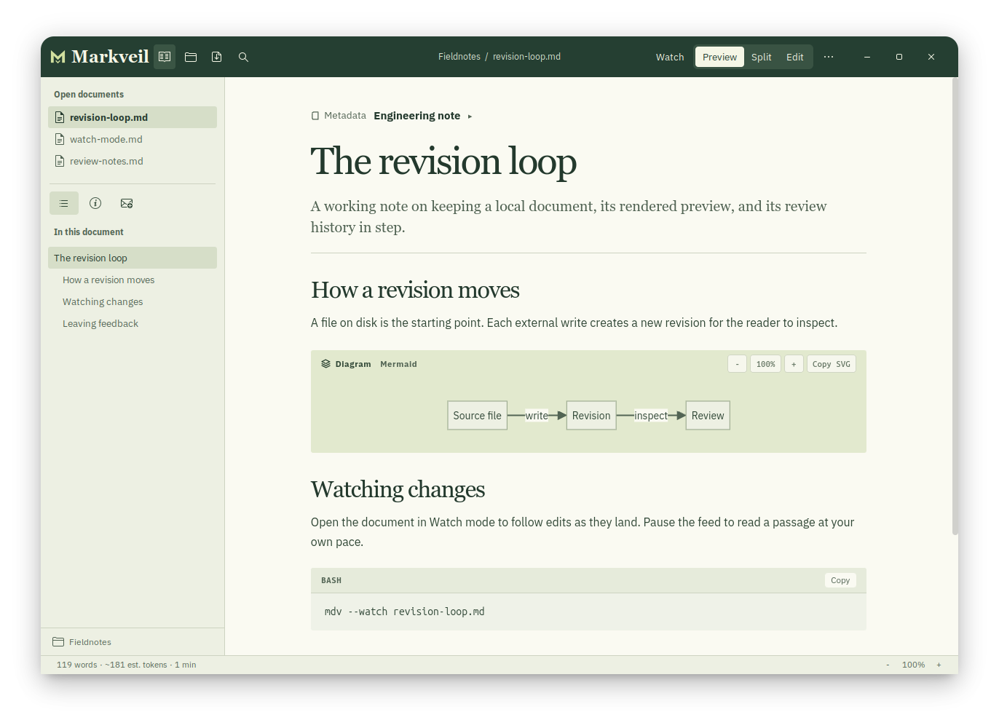
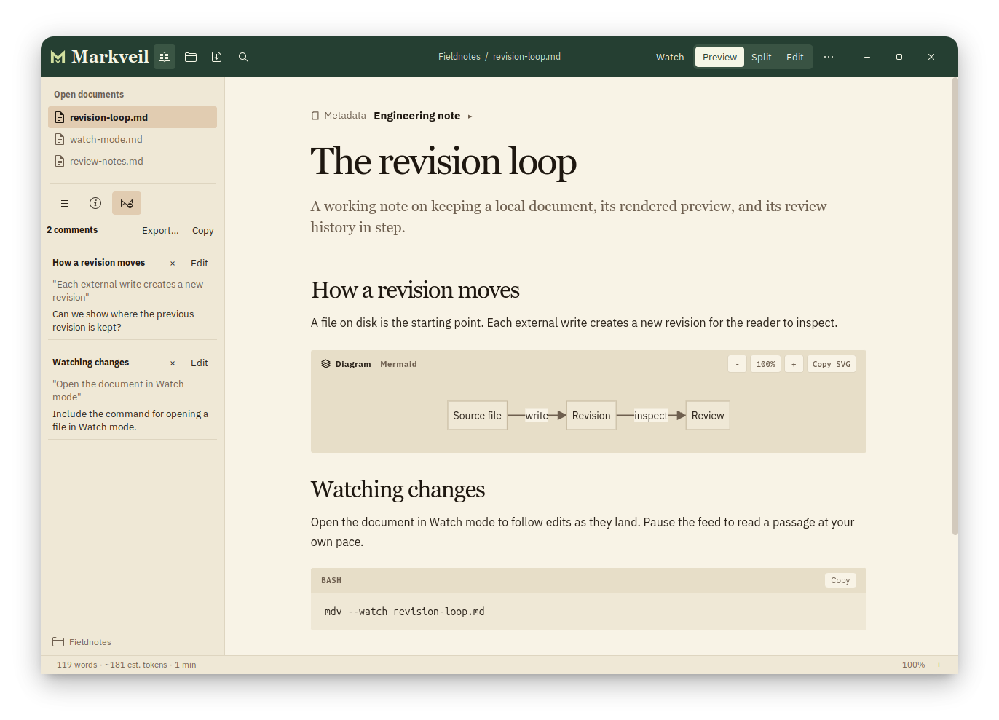

<div align="center">
  
  <h1>Markveil</h1>
  <p><strong>Native GTK3 + WebKit2 Markdown studio for Linux and local coding-agent workflows.</strong></p>
  <p>Offline KaTeX and Mermaid · Watch mode · Context token inspector · Visual diffs · Portable <code>*.review.md</code> feedback</p>
</div>

<p align="center">
  
</p>

## Why Markveil

Most Linux Markdown tools fall into two groups: Electron workspaces that consume hundreds of megabytes of RAM, or bare readers that lack Mermaid diagrams, math, diffs, and live reload. **Markveil** (`markveil`, short alias `mdv`, compatibility alias `md-viewer`) is a native desktop app built for reading, editing, and reviewing technical Markdown and agent-generated plans.

| Capability | Markveil (`mdv`) | Electron apps (Obsidian, VS Code) | Minimal viewers |
|---|---|---|---|
| Cold CLI startup | ~170 ms | 1.5 - 4 s | <50 ms |
| Native GTK3 + WebKit2 | Yes (no Electron or Node) | No (Chromium) | Terminal or basic widget |
| Offline KaTeX + Mermaid | Bundled locally | Plugin or network dependent | Usually unsupported |
| Watch mode + changed-block highlight | Built-in (`-w`) | External extension | None |
| Context and `SKILL.md` token inspector | Built-in | None | None |
| Portable `*.review.md` export | Built-in | None | None |
| Visual `--git-diff` and `--diff` | Built-in | Git extension | Text only |
| Local CLI agent (`claude`, `codex`, `agy`) | Built-in (`Ctrl+Shift+A`) | Paid add-on or extension | None |

Tradeoffs: Markveil targets Linux desktops with GTK3 and WebKit2GTK 4.1. It has no cloud sync, vault graph, or plugin marketplace.

## The Folio workspace

Folio opens new installations with a forest-green toolbar, sage sidebar, and ivory reading surface. Select a file under **Open documents**, then use **Outline**, **Context**, or **Comments** below it. Collapse the sidebar with `Ctrl+B` to give the document more room. When multiple files are open, their tabs move above the document.

Choose **Preview**, **Split**, or **Edit** in the toolbar. The menu contains **Ask local agent**, theme switching, and preferences. Existing theme and sidebar preferences carry over. To open a document in Folio, run `mdv --theme folio README.md`.

## Screenshots

<table>
  <tr>
    <td width="50%" valign="top">
      
      <p align="center"><strong>Split view (Paper).</strong> <code>GtkSourceView</code> with debounced live preview, proportional scroll sync, open-document navigation, and a collapsible heading outline.</p>
    </td>
    <td width="50%" valign="top">
      
      <p align="center"><strong>Visual diff review.</strong> Compare against previous watched revisions, <code>git HEAD</code>, or another file with heading context and word-level highlights.</p>
    </td>
  </tr>
  <tr>
    <td width="50%" valign="top">
      
      <p align="center"><strong>Watch mode (Obsidian).</strong> Follow revisions on disk and inspect the document’s token estimate.</p>
    </td>
    <td width="50%" valign="top">
      
      <p align="center"><strong>Portable review comments (Sepia).</strong> Select text in Preview, attach feedback, and export a <code>*.review.md</code> file for any coding agent.</p>
    </td>
  </tr>
</table>

## Workflows

### Watch mode
Open a file with `mdv -w PLAN.md` or press `Ctrl+Shift+W`. When an external tool or coding agent writes to the file on disk, Markveil reloads it through `Gio.FileMonitor` with no modal confirmation dialogs and highlights changed blocks in place (`[data-changed="true"]`). You can pause updates or toggle **Follow changes** from the Watch bar.

### Context and token inspector
Open the sidebar (`Ctrl+B` or `F9`) to inspect word count, byte size, reading time, and heuristic token estimates split across prose (~4.2 chars/token) and fenced code (~3.4 chars/token). Each heading shows its token share and flags sections over 2,000 estimated tokens. For `SKILL.md` files, the inspector checks YAML frontmatter for `name` and `description`.

### Visual diff review
Press `Ctrl+D` or launch from a terminal with `--git-diff` or `--diff` to compare against the previous watched revision, `git HEAD`, or another file. Diffs display hunk counts, the nearest preceding Markdown heading, and word-level insertions and deletions in Unified or Side-by-Side layout.

### Review comments (`*.review.md`)
Select text in Preview and click **Add comment** to attach feedback, then export a sidecar file (`<stem>.review.md`, headed `# Review: <filename>`). Any coding agent can read the quoted excerpt and `Feedback:` block directly without IDE plugins.

### Ask local agent
Press `Ctrl+Shift+A` to run a locally installed CLI agent (`claude`, `codex`, or `agy`) asynchronously against the active document (bounded to 32,000 characters) with built-in prompts (`Summarize`, `Find Gaps`, `Check Architecture`, `Tighten Prose`) or a custom question.

### CLI and stdin piping
Open multiple tabs, jump directly to `--line` or `--section`, launch split or edit views, or pipe command output into a rendered tab with `... | mdv -`.

### Clipboard studio (`Super+Shift+M`)
Press `Super+Shift+M` on GNOME or run `md-viewer-clipboard` or `mdv --clipboard` to open clipboard contents in studio mode. A pure-Python `html.parser` converter turns copied rich HTML from browsers or docs into Markdown on demand without running a background daemon.

### Technical file views
Open `.json`, `.jsonc`, `.yaml`, `.yml`, `.toml`, `.diff`, `.patch`, `.mmd`, `.mermaid`, and `.txt` files directly. JSON, JSONC, YAML, and TOML views display parse validity badges alongside syntax-highlighted or collapsible tree output.

## Installation

Install system prerequisites on Ubuntu or Debian:

```bash
sudo apt install python3-gi gir1.2-gtk-3.0 gir1.2-webkit2-4.1 gir1.2-gtksource-3.0 python3-pygments
```

Ensure [`uv`](https://docs.astral.sh/uv/) is installed, then run:

```bash
bash setup.sh
```

`setup.sh` performs six steps:
1. Marks `markveil`, `mdv`, `md-viewer`, `md-viewer-clipboard`, and `md_viewer.py` executable.
2. Creates `.venv` with `--system-site-packages` via `uv` and installs `markdown` and `pyyaml`.
3. Verifies GTK3, WebKit2 4.1, GtkSource 300, Pygments, `mdviewer` imports, icons, and bundled KaTeX and Mermaid assets.
4. Symlinks `markveil`, `mdv`, `md-viewer` (compatibility alias), and `md-viewer-clipboard` into `~/.local/bin/`.
5. Installs SVG and PNG icons into `~/.local/share/icons/hicolor/`, installs `.desktop` entries into `~/.local/share/applications/`, and sets `markveil.desktop` as the default handler for `text/markdown` and `text/x-markdown` without changing `.json` or `.txt` defaults.
6. Registers `Super+Shift+M` as a GNOME custom keybinding when `gsettings` is writable, and skips it on KDE, Sway, Hyprland, XFCE, or headless environments.

## CLI reference

`markveil`, `mdv`, and `md-viewer` accept the same arguments.

```bash
# Open one or more files in tabs
mdv README.md docs/architecture.md

# Open in Watch mode at a heading or line
mdv -w --section "Rollout" PLAN.md
mdv -w --line 42 NOTES.md

# Open directly in Edit or Split view
mdv -e notes.md
mdv -s notes.md

# Minimal reader or read-only mode
mdv -q spec.md
mdv --readonly release-notes.md

# Visual diff against git HEAD or between two files
mdv --git-diff README.md
mdv --diff PLAN.v1.md PLAN.v2.md

# Pipe command output or Markdown via stdin
git diff --stat | mdv -
cat report.md | mdv

# Launch Clipboard studio with a theme override
mdv --clipboard --theme obsidian
```

| Flag | Description |
|---|---|
| `files` | Files to open, or `-` to read Markdown from `stdin` |
| `-e`, `--edit` | Open in source editor view |
| `-s`, `--split` | Open in side-by-side split edit/preview mode |
| `-w`, `--watch` | Enable Watch mode (live reload and changed-block highlight) |
| `-q`, `--quick` | Minimal reader mode |
| `--readonly` | Disable editing and saving |
| `--clipboard` | Open system clipboard with HTML-to-Markdown conversion |
| `--diff FILE_A FILE_B` | Compare two files in diff view |
| `--git-diff FILE` | Compare working-tree file against `git HEAD` |
| `--line N` | Jump to 1-based line `N` on open |
| `--section NAME` | Jump to heading `NAME` on open |
| `--theme NAME` | Override theme: `auto`, `folio`, `paper`, `obsidian`, `sepia`, `nordic` |
| `--version` | Print Markveil version and exit |

## Keyboard shortcuts

### Application and editor

| Action | Shortcut |
|---|---|
| New tab | `Ctrl+N` |
| Open | `Ctrl+O` |
| Close tab | `Ctrl+W` |
| Save | `Ctrl+S` |
| Save as | `Ctrl+Shift+S` |
| Cycle view (Preview / Split / Edit) | `Ctrl+E` |
| Toggle split | `Ctrl+\` |
| Refresh | `Ctrl+R` |
| Toggle sidebar | `Ctrl+B` / `F9` |
| Find | `Ctrl+F` |
| Find and replace | `Ctrl+H` |
| Toggle Watch mode | `Ctrl+Shift+W` |
| Diff view | `Ctrl+D` |
| Ask local agent | `Ctrl+Shift+A` |
| Cycle theme (`Folio` / `Paper` / `Obsidian` / `Sepia` / `Nordic`) | `Ctrl+T` |
| Print or export PDF | `Ctrl+P` |
| Zoom | `Ctrl++` / `Ctrl+-` / `Ctrl+0` |
| Link history | `Alt+Left` / `Alt+Right` |
| Switch tabs | `Ctrl+Tab` / `Ctrl+Shift+Tab` |
| Copy file path | `Ctrl+Shift+C` |
| Shortcuts | `Ctrl+?` / `F1` |
| Quit | `Ctrl+Q` |

### Preview Vim navigation

| Action | Keys |
|---|---|
| Scroll down / up | `j` / `k` |
| Half-page down / up | `d` / `u` |
| Top / bottom of document | `gg` / `G` |
| Previous / next heading | `[` / `]` |
| Open find bar | `/` |

### Global

| Action | Shortcut |
|---|---|
| Clipboard studio | `Super+Shift+M` |

## Security

Markveil renders untrusted Markdown inside a restricted local WebKit2 context:

1. **Per-render CSP nonces.** Every render generates a fresh `secrets.token_urlsafe(16)` nonce. The document CSP enforces `default-src 'none'`, `script-src 'nonce-<nonce>'`, `connect-src 'none'`, `media-src 'none'`, `object-src 'none'`, and `frame-src 'none'`.
2. **HTML parser allowlist sanitization.** `mdviewer/sanitizer.py` parses rendered HTML with Python's `html.parser.HTMLParser`. It strips dangerous tags and their content (`script`, `style`, `iframe`, `frame`, `frameset`, `object`, `embed`, `applet`, `noscript`, `template`, `textarea`, `select`, `form`, `meta`, `base`, `link`, `svg`), removes all `on*` event attributes, `srcdoc`, `formaction`, and arbitrary inline `style` (allowing only `text-align` on `th` and `td`), restricts `<input>` to task checkboxes, and rejects `javascript:`, `vbscript:`, `data:text/html`, and `data:image/svg+xml` URLs.
3. **Strict Mermaid mode.** KaTeX and Mermaid containers are restored from escaped attributes after HTML sanitization, and Mermaid runs with `securityLevel: "strict"`.
4. **WebKit2 isolation.** WebKit2 settings enforce `allow_universal_access_from_file_urls(False)` and `enable_page_cache(False)`. External links open in the system browser through `decide-policy`.
5. **Remote image gate.** Remote `http:` and `https:` image sources are blocked by default (`allow_remote_images = False`) and rewritten to `data-blocked-src` placeholders until you allow them.

## Agent skill

Coding agents (Claude Code, Codex, OpenCode, Antigravity) can load [`skills/markveil/SKILL.md`](skills/markveil/SKILL.md) to open plans in Watch mode, launch `--git-diff` reviews, pipe terminal output to `mdv -`, and apply exported `*.review.md` feedback files.

## Dependencies

- Python 3.12+ (system)
- PyGObject / GTK 3 (`python3-gi`, `gir1.2-gtk-3.0`)
- WebKit2GTK 4.1 (`gir1.2-webkit2-4.1`)
- GtkSourceView 300 (`gir1.2-gtksource-3.0`)
- Pygments (`python3-pygments`)
- `markdown` and `pyyaml` (installed into `.venv` via `uv`)
- Bundled offline assets in `assets/vendor/`: KaTeX and Mermaid
